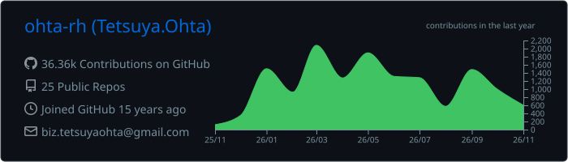
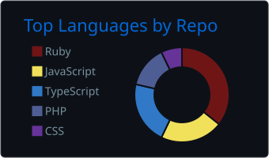
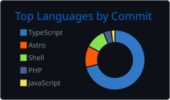
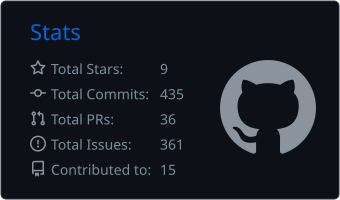
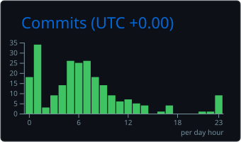

<h1 align="center">Hi there, I'm ohta-rh 👋</h1>

  
  

## 🐍 Contribution Snake

  <picture>
    <source media="(prefers-color-scheme: dark)" srcset="https://raw.githubusercontent.com/ohta-rh/ohta-rh/output/github-snake-dark.svg" />
    <source media="(prefers-color-scheme: light)" srcset="https://raw.githubusercontent.com/ohta-rh/ohta-rh/output/github-snake.svg" />
    
  </picture>

## 📈 Activity Graph

  

## 🔥 Streak

  <a href="https://git.io/streak-stats">
    <picture>
      <source media="(prefers-color-scheme: dark)" srcset="https://streak-stats.demolab.com/?user=ohta-rh&theme=dark&hide_border=true" />
      
    </picture>
  </a>

## 📊 Summary

  

  
  

  
  

## 🏆 Trophies

  

